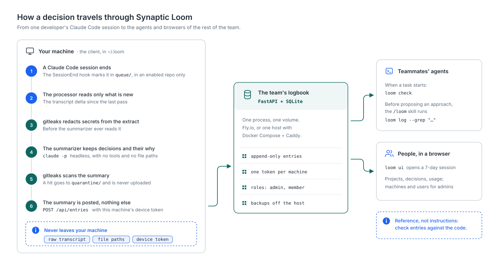

# Synaptic Loom

[](https://github.com/DiegoSanC/synaptic-loom/actions/workflows/ci.yml)
[](LICENSE)

**A team logbook of the decisions, and the reasoning behind them, captured from Claude Code
sessions.**

When a team builds with coding agents, the code moves faster than anyone's understanding
of it. Reviewing a teammate's work, or inheriting a project, means reconstructing *what*
was decided and *why* from a diff that no longer says. The reasons were in the agent
sessions, and those stay on one person's laptop.

Synaptic Loom keeps them. When a session ends in a repo you chose to share, your machine
summarizes the decisions, facts, methods and open tasks it contains, checks the summary
for secrets, and posts **only that summary** to a small server your team runs. Your
teammates' agents read the logbook before they propose an approach, and people can browse
it on the web.

## How it works



- **Capture is opt-in, per project and per machine.** `loom register` adds a project to
  the logbook; `loom enable` lets this machine contribute to it. Nothing is captured from
  a repo you did not enable, nor from before you enabled it.
- **The summary leaves your machine, and so does the redacted conversation it was written
  from.** gitleaks redacts the extract before the summarizer reads it, and that redacted
  text is what the server keeps next to the entry (never searched; a team admin can turn
  it off per project). The summary is scanned again before it is posted; a hit is
  quarantined, never uploaded. The raw transcript and your token never leave. The
  summarizer runs headless with no tools at all. Details: [What actually leaves your
  machine](docs/USER-GUIDE.md#what-actually-leaves-your-machine).
- **Entries are append-only.** A later decision is linked to the one it replaces, and the
  logbook stops presenting the old one as current.
- **The logbook is reference, not instruction.** Every read opens with a line saying so,
  and the agent is told to check entries against the code.

## What you get

| | |
|---|---|
| **Automatic capture** | A Claude Code `SessionEnd` hook plus a 15-minute safety-net job (systemd user timer or cron). Killed and crashed sessions are picked up too. |
| **Typed, addressable items** | Each summary lists `[decision]`, `[fact]`, `[method]` and `[task]` items, each with its rationale and status. |
| **Consumption by agents** | A `CLAUDE.md` block and the `/loom` skill make your agent run `loom check` when a task starts and search the logbook (`loom log --grep`) before proposing an approach. |
| **A web UI** | `loom ui` opens a signed-in browser session: projects, entries, usage, your machines; users and roles for admins. |
| **Onboarding without shared secrets** | Single-use invitation links; each machine mints its own device token, which renews itself. Add another machine of yours with a setup code from the web. |
| **Revocation that holds** | *Retire* a replaced machine, or *Revoke* a lost one together with every machine added from it. |
| **Feedback and curation** | Mark entries as useful, not applicable or stale (`/loom-feedback`); `loom curate` links superseded decisions. |
| **One small server** | FastAPI + SQLite, one process, one volume. Deploy guides for Fly.io and for any Linux host with Docker Compose + Caddy, including backups pulled off the host and a restore drill. |

## Status

**v0.1.0, a working pilot.** It runs for a small team and has been driven end to end on
real hosts: Fly.io, and a VPS with Docker Compose and a public certificate. It is still
under active development; expect changes between versions. Before upgrading a server,
take a backup and follow the upgrade checks in the [runbook](docs/RUNBOOK.md).

**It works with Claude Code only, for now.** The design keeps the agent-specific parts at
the edges, so adapting it to Codex or another agent harness should be contained. These
are the places that know about Claude Code:

| Seam | Today | For another harness |
|---|---|---|
| Session end | Claude Code's `SessionEnd` hook (`client/hooks/sessionend.sh`) | The harness's own end-of-session hook, or the existing periodic sweep alone |
| Transcript | Claude Code's JSONL transcripts (`client/loom/transcript_adapter.py`, `contract/SCHEMA.md`) | An adapter for that harness's transcript format |
| Summarizer | `claude -p` headless, with no tools (`contract/FLAGS.md`) | Any CLI or API that takes the prompt in `prompts/` and returns Markdown |
| Consumption | A `CLAUDE.md` block and skills under `client/skills/` | The harness's equivalent (`AGENTS.md`, its skill or command format) |

The server, its API, the web UI and the logbook format are agent-agnostic.

## Getting started

- **Use it on your machine:** [User guide](docs/USER-GUIDE.md). You need an invitation
  link from whoever runs your team's server, `git`, `jq`, Python 3.12+ and the Claude Code
  CLI; the installer fetches a pinned gitleaks for you.
- **Run the server for your team:** [Server guide](docs/SERVER-GUIDE.md): Fly.io (Part 1)
  or one Linux host with Docker Compose + Caddy (Part 2). Then
  `python -m server.admin invite --email you@example.com --name you` and
  `python -m server.admin promote --email you@example.com` make you the first admin.
- **Operate it:** [Runbook](docs/RUNBOOK.md): upgrades, backups, revocation, diagnostics.

## Repository layout

```
server/            # FastAPI API, web UI (/ui), SQLite schema and migrations, admin CLI
  admin.py         # adduser, invite, promote, demote, deactivate, listusers,
                   # listdevices, revokedevice, revoke-orphans
client/
  loom/            # the `loom` CLI: process, register, enable, check, log, ui, status,
                   # enroll, doctor, curate, feedback, …
  hooks/           # the SessionEnd hook
  skills/          # Claude Code skills: loom, loom-register, loom-feedback
  install.sh       # idempotent installer (venv, hook, skills, scheduled job, gitleaks)
prompts/           # versioned summarizer prompts
contract/          # verified facts about the Claude Code CLI and transcript format,
                   # and the project-attribution rule (ATTRIBUTION.md)
deploy/compose/    # Docker Compose + Caddy deployment, backups and restore.sh
fly.toml           # Fly.io deployment
test/waves/        # frozen goal tests that drive the real boundary (Docker, real image)
docs/              # user, server and operations guides; the README diagram
```

## Development

```bash
uv venv .venv && uv pip install --python .venv/bin/python -e '.[server,client,dev]'
make test                       # needs a running Docker daemon and gitleaks 8.30.1
LOOM_SKIP_LIVE=1 make contract  # static contract assertions
```

Read [`AGENTS.md`](AGENTS.md) first: it is the working doctrine for humans and agents
(test-first, real-boundary tests, frozen goal waves, shared contracts are read-only) and
lists the environment the suite needs. [`DESIGN.md`](DESIGN.md) is the specification, with
every decision recorded as `D<n>`. CI runs `make test` and the static contract on every
push and pull request.

Issue, PR and commit references in older docs and code comments (`#N`, or a commit hash)
may refer to the original development repository and not resolve here.

## Security

Please report vulnerabilities privately: see [SECURITY.md](SECURITY.md).

## License

[Apache License 2.0](LICENSE).
